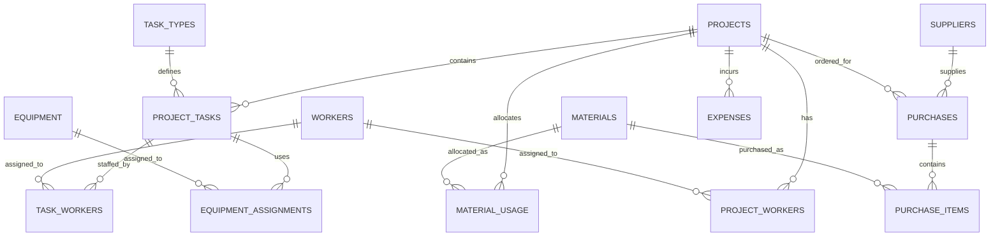

# BuildCore Infrastructure: Complete Project Guide

This guide explains how the BuildCore construction project and resource management application is built, how its tables relate, and how its main workflows operate. It describes the implementation in this repository, not an idealized design.

## 1. What BuildCore Does

BuildCore is a web application for managing construction projects and their operational resources. It brings together:

- Projects, schedules, and project progress
- Reusable task definitions and project-specific task instances
- Workers and equipment assigned to tasks
- Materials, suppliers, purchase orders, and allocations
- Project expenses, financial summaries, and reports
- User login

The database is central to the design. PostgreSQL stores the authoritative records, enforces relationships and validation constraints, and provides SQL views for calculations used by multiple screens.

## 2. Architecture

The application follows a familiar server-rendered web pattern:

```text
Browser
  -> Flask route in routes/
  -> SQL statement through SQLAlchemy
  -> PostgreSQL table or view
  -> Route passes rows to a Jinja template
  -> HTML response rendered with Bootstrap
```

### Main layers

| Layer             | Responsibility                                                                   | Where to look                                                                    |
| ----------------- | -------------------------------------------------------------------------------- | -------------------------------------------------------------------------------- |
| Flask application | Creates the app, configures extensions, handles authentication, registers routes | [app.py](app.py)                                                                  |
| Configuration     | Loads database settings and the Flask secret key from environment variables      | [config.py](config.py)                                                            |
| Route modules     | Handle page requests, query/update data, and choose templates                    | [routes/](routes/)                                                                |
| Database          | Defines tables, keys, constraints, seed data, and calculated views               | [database/schema.sql](database/schema.sql), [database/seed.sql](database/seed.sql) |
| Templates         | Render the pages and forms with Jinja and Bootstrap                              | [templates/](templates/)                                                          |
| Setup             | Executes the schema and demo seed scripts                                        | [setup_db.py](setup_db.py)                                                        |

The application mostly uses SQLAlchemy as a connection and transaction interface, while writing explicit SQL with `text()`. The routes are therefore a good place to see exactly which SQL operation backs a screen. A successful insert/update is generally followed by `db.session.commit()`; reads use `fetchone()` or `fetchall()` and pass their results into `render_template()`.

### Route modules

| Module                                      | Main responsibility                                                             |
| ------------------------------------------- | ------------------------------------------------------------------------------- |
| [routes/dashboard.py](routes/dashboard.py)   | Main dashboard counts and active project progress                               |
| [routes/projects.py](routes/projects.py)     | Project CRUD, project detail, project tasks/resources, and task lookup endpoint |
| [routes/tasks.py](routes/tasks.py)           | Reusable task types and project-specific task assignment/editing                |
| [routes/workers.py](routes/workers.py)       | Worker records and task assignments                                             |
| [routes/equipment.py](routes/equipment.py)   | Equipment records and date-bounded task assignments                             |
| [routes/materials.py](routes/materials.py)   | Material catalogue and allocation to projects                                   |
| [routes/suppliers.py](routes/suppliers.py)   | Supplier records and related purchase list                                      |
| [routes/purchases.py](routes/purchases.py)   | Purchase orders and their line items                                            |
| [routes/financials.py](routes/financials.py) | Project financial summaries and miscellaneous expenses                          |
| [routes/reports.py](routes/reports.py)       | Progress, financial, resource, and procurement reports                          |

The shared [templates/base.html](templates/base.html) supplies the navigation and common page structure. Individual templates under `templates/` render the data returned by their route.

## 3. The Central Data Model

The key distinction in the work-planning model is between a **task type** and a **project task**:

- `task_types` is a reusable catalogue of activities, such as “Foundation” or “Painting.”
- `project_tasks` is a specific instance of an activity on one project. It stores that project's dates, status, completion percentage, and description.

For exaīmple, the `Foundation` task type may be used by several projects. Each use has a separate `project_task_id` and its own timeline and progress. Workers and equipment attach to this project-specific task, which gives their assignment an unambiguous project context.

### Relationship diagram



The `||` end means one required parent row; the `o{` end means zero or more child rows. For example, each `project_tasks` row references exactly one project, while a project can have no tasks or many tasks.

### Tables and what each one represents

| Table                     | Meaning and key relationship                                                                                                                                                                                                                     |
| ------------------------- | ------------------------------------------------------------------------------------------------------------------------------------------------------------------------------------------------------------------------------------------------ |
| `users`                 | Login accounts.`user_id` is the primary key; `username` is unique. This table is not connected to projects through a foreign key.                                                                                                            |
| `projects`              | Project identity, client, location, dates, budget, and status.`project_id` is referenced by project-owned task, purchase, expense, and allocation records.                                                                                     |
| `task_types`            | Reusable activity catalogue.`task_type_id` is the primary key and `task_name` is unique.                                                                                                                                                     |
| `project_tasks`         | A task type scheduled for a particular project.`project_id` references `projects`; `task_type_id` references `task_types`. A unique constraint on `(project_id, task_type_id)` allows at most one instance of a task type per project. |
| `workers`               | Worker details and current stored status, including role, skill, phone, and daily rate.                                                                                                                                                          |
| `task_workers`          | Junction between workers and project tasks. It records`assigned_hours` and `locked_daily_rate` for that assignment.                                                                                                                          |
| `project_workers`       | Junction between workers and projects for project-level assignment dates and role. It is populated by seed data, but current worker assignment routes use`task_workers` instead.                                                               |
| `equipment`             | Equipment details, stored status, and hourly rate.                                                                                                                                                                                               |
| `equipment_assignments` | Junction between equipment and project tasks, with assignment dates, hours used, and`locked_hourly_rate`.                                                                                                                                      |
| `materials`             | Material catalogue with unit and reference unit cost. It does not represent stock on hand.                                                                                                                                                       |
| `material_usage`        | Project-specific material allocation/usage records. The Materials module summarizes these records across projects; it is not a shared inventory pool.                                                                                           |
| `suppliers`             | Supplier contact and address details.                                                                                                                                                                                                            |
| `purchases`             | Purchase order header. Each purchase refers to one supplier and one project.                                                                                                                                                                     |
| `purchase_items`        | Purchase-order lines. Each line references one purchase and one material and stores quantity and actual unit price.                                                                                                                              |
| `expenses`              | Other/manual expense entries attached directly to a project.                                                                                                                                                                                     |

The schema's initial cleanup section mentions a table called `tasks`, but the current schema does not create it. The current task design is `task_types` plus `project_tasks`.

## 4. Primary Keys, Foreign Keys, and Constraints

Most tables have a generated integer primary key such as `project_id`, `worker_id`, or `purchase_id`. A primary key uniquely identifies one row. A foreign key stores a reference to another table's primary key and lets PostgreSQL reject references to nonexistent records.

Examples:

```text
project_tasks.project_id       -> projects.project_id
project_tasks.task_type_id     -> task_types.task_type_id
task_workers.project_task_id   -> project_tasks.project_task_id
task_workers.worker_id         -> workers.worker_id
purchase_items.purchase_id     -> purchases.purchase_id
purchase_items.material_id     -> materials.material_id
```

The schema also establishes important data checks:

- Project budgets and worker/equipment/material rates cannot be negative.
- Project expected end date cannot precede project start date.
- Project task due date cannot precede its start date.
- Project task completion must be between 0 and 100.
- Purchase item quantity must be greater than zero.
- Material allocated/used quantities cannot be negative, and used quantity cannot exceed allocated quantity.
- Equipment assignment end date, when present, cannot precede its start date.
- A project cannot receive the same task type twice because of `UNIQUE (project_id, task_type_id)`.

Some rules are enforced by Python routes rather than database constraints. Task routes check that a task's dates lie inside the project's dates. The database checks that the task's own end date is not earlier than its start date, but it does not enforce the cross-table project timeline rule.

### Delete behavior

Foreign-key `ON DELETE` rules define what happens when a parent is removed:

- Deleting a project cascades to its project tasks, purchases, project worker assignments, material allocations, and expenses. Dependent task-worker, equipment-assignment, and purchase-item rows then cascade from their parent task/purchase rows.
- Deleting a worker cascades to its worker assignment rows; deleting equipment cascades to its equipment assignments.
- Deleting a supplier is restricted while a purchase refers to it.
- Deleting a material is restricted while a purchase item refers to it. Its `material_usage` rows are configured to cascade.
- Deleting a task type is restricted while project task instances refer to it.

These are foreign-key actions, not custom database triggers.

## 5. SQL Views: Calculations Shared Across Screens

A SQL view behaves like a saved query. It does not store a second copy of the calculated result; querying it derives the result from the current source tables.

### `project_progress_view`

The view calculates project progress as a **duration-weighted average**, not a plain average. Each task's weight is its inclusive calendar-day span:

$$
\text{Project Progress} =
\frac{\sum(\text{task completion percentage} \times \text{task duration in days})}
     {\sum(\text{task duration in days})}
$$

The SQL duration is `due_date - start_date + 1`. A task scheduled for 10 days at 80% and another scheduled for 30 days at 20% result in:

```text
(80 x 10 + 20 x 30) / (10 + 30) = 35%
```

Thus the longer task has more influence. The view also counts total tasks and tasks whose status is exactly `Completed`. Status does not determine the progress percentage; `completion_percentage` does. Projects with no tasks return 0% progress. The dashboard, project list/detail, and progress report query this shared view.

### `purchases_with_total_view`

This view calculates each purchase order's total from its line items:

```text
Purchase total = sum(quantity x unit_price for each purchase item)
```

The calculated total is not separately stored in `purchases`.

### `worker_status_view`

The view preserves `On Leave` and `Inactive`. Otherwise, if a worker has an assignment to a project task whose status is `In Progress` or `Not Started`, the view reports `Assigned`; otherwise it reports `Available`. This is a derived display status. It does not update the stored `workers.status` column.

### `equipment_status_view`

The view preserves `Maintenance` and `Retired`. Otherwise, equipment is shown as `In Use` if an assignment covers the current date; if not, it is shown as `Available`. This is also derived at query time.

### `expense_ledger_view`

The ledger combines four source streams using `UNION ALL`:

| Ledger category | Source and current calculation                                                                                             |
| --------------- | -------------------------------------------------------------------------------------------------------------------------- |
| Materials       | Purchase item quantity multiplied by its purchase unit price. Only purchase statuses`Delivered` and `Completed` count. |
| Labour          | `assigned_hours / 8 x locked_daily_rate` from `task_workers`.                                                          |
| Equipment       | `hours_used x locked_hourly_rate` from `equipment_assignments`.                                                        |
| Other           | Direct amount from`expenses`.                                                                                            |

The source tables remain authoritative. The view unifies them for financial pages without duplicating transactions in a separate ledger table.

## 6. Main Workflows

### A. Create a project and plan its work

1. A project form submits to a route in `routes/projects.py`.
2. The route inserts the project in `projects`; PostgreSQL assigns its `project_id`.
3. A reusable task type is selected or created in `task_types`.
4. Assigning that task type to the project creates one `project_tasks` row with dates, status, completion, and description.
5. The task row becomes the anchor for assigning workers and equipment.

The unique `(project_id, task_type_id)` constraint prevents duplicate instances of the same task type for a project.

### B. Assign workers and equipment

Workers are assigned to a `project_task_id`, creating a row in `task_workers`. That row includes hours and snapshots the worker's current daily rate into `locked_daily_rate`.

Equipment is also assigned to a `project_task_id`, creating a row in `equipment_assignments`. The route checks for date overlap against existing assignments for that equipment and snapshots its current hourly rate into `locked_hourly_rate`.

The locked rates make old assignment costs stable when the current catalogue rate changes. They are used by the financial ledger.

### C. Purchase and review materials

1. A purchase order row in `purchases` links one supplier with one project.
2. Each product/quantity/price line becomes a `purchase_items` row.
3. `purchases_with_total_view` derives the purchase total from those lines.
4. Purchase quantities and prices remain associated with the project on the purchase order.
5. The Materials module provides a consolidated read-only view of project allocations and usage recorded in `material_usage`.

The Materials module does not allocate stock or compare purchases against allocations. The current application displays existing `material_usage` records and does not provide a route for creating or editing them.

### D. Record and review costs

Labour and equipment costs originate from their task assignment rows. Materials costs originate from delivered/completed purchase items. Other costs are entered directly into `expenses`.

`routes/financials.py` queries the ledger for project totals and categories, compares total cost with the project's budget, and displays the transaction details. `routes/reports.py` combines financial, progress, resource, and procurement summaries, with an optional project filter.

### E. Update task progress

The project-specific task edit route updates dates, status, percentage, and description in `project_tasks`. Because project progress is read from a SQL view, the project-level percentage changes automatically on the next query. There is no separate stored project percentage to keep synchronized.

## 7. Authentication and Configuration

`app.py` defines the Flask-Login user loader and the `User` model for the `users` table. Login looks up the username and checks the supplied password against its Werkzeug password hash. The `create-admin` Flask CLI command creates or updates the account with a generated hash. Feature routes generally use `@login_required`.

There is no separate role/permission model in the current schema, so logged-in users share the same feature access. The root landing page and login route are public. `SECRET_KEY` should be set to a private value outside development; `config.py` contains a development fallback.

Database configuration in [config.py](config.py) reads `DB_USER`, `DB_PASSWORD`, `DB_HOST`, `DB_PORT`, and `DB_NAME` and constructs a PostgreSQL connection string. The README mentions `DATABASE_URL`, but current config does not read that variable.

## 8. Setup and Important Safety Warning

[setup_db.py](setup_db.py) executes `database/schema.sql` followed by `database/seed.sql`. This is a **destructive fresh/demo setup**, not a migration:

- `schema.sql` drops existing views and tables before recreating them.
- `seed.sql` truncates tables and resets identity counters before inserting sample data.

Do not run `python setup_db.py` on a database containing data you need to retain. The repository does not currently provide a versioned, non-destructive migration framework in these setup files.

The usual local setup flow is to configure the database environment variables, install [requirements.txt](requirements.txt), run the setup script against a new development database, create the admin account using the Flask CLI, and start Flask in development mode. Do not expose the Flask debug server as a production deployment.

## 9. Important Implementation Details and Caveats

These points help distinguish current behavior from assumptions a reader might make:

- **Project progress is duration-weighted.** It is not a simple average and is not weighted by budget or resource cost.
- **Task status and task percentage are separate inputs.** A status of `Completed` does not automatically set percentage to 100, and a percentage of 100 does not automatically change status.
- **Task scheduling uses calendar days.** The SQL view does not exclude weekends or holidays.
- **The financial ledger filters purchases by status.** Only `Delivered` and `Completed` purchase items count as material cost.
- **Dashboard purchase totals have a different meaning.** The dashboard sums purchase totals from `purchases_with_total_view` without applying the ledger's delivered/completed filter, so that headline is not necessarily the same as recognized financial material cost.
- **Some reports use live rates.** The expense ledger uses locked assignment rates; resource utilization queries in `routes/reports.py` calculate costs using current `workers.daily_rate` and `equipment.hourly_rate`. Those report figures can differ from ledger figures if catalogue rates have changed since assignment.
- **Equipment availability and the dashboard equipment count differ.** Equipment pages use `equipment_status_view`; the dashboard count queries the stored `equipment.status` directly.
- **Material allocations are project-level.** `material_usage` references a project, not a project task.
- **Materials are not centrally stocked.** Purchases are linked to projects, and the Materials module only summarizes project allocation and usage records; it does not calculate available inventory.
- **`project_workers` is not the task assignment mechanism.** Current worker assignment routes use `task_workers`.
- **The README's database setup wording is partly stale.** It describes `DATABASE_URL` and cascade triggers; current config uses `DB_*` variables and the schema uses foreign-key cascade rules.

## 10. How to Read the Code for a Feature

For any screen, trace it in this order:

1. Find the route in the matching `routes/*.py` file.
2. Read the SQL statement to see which tables or views supply its data.
3. Follow each foreign key in `database/schema.sql` to understand how the rows connect.
4. Inspect the matching `templates/` file to see which returned fields are shown and which actions/forms are offered.
5. For computed values, find the SQL view definition before assuming the template or Python route calculates it.

For example, to understand a project's progress, start at the project route, see that it joins `project_progress_view`, then inspect that view in `database/schema.sql`; the template only formats and displays the returned percentage.

## 11. The Whole System in One Picture

```text
Projects define the work.
Task types name reusable activities.
Project tasks schedule those activities on specific projects.
Workers and equipment attach to project tasks.
Purchases connect suppliers, projects, materials, quantities, and prices.
Material usage records project-level allocations.
Expenses add other project costs.
SQL views calculate shared progress, status, purchase totals, and ledger rows.
Flask routes read/write the data; Jinja templates render it for users.
```

The most important table to understand is `project_tasks`: it joins project planning to task-level work and resource assignments. The most important database design idea is that many-to-many relationships use junction tables, because those relationships need their own dates, quantities, hours, rates, or roles. The most important calculation design idea is that shared summaries are derived in SQL views from source records rather than maintained as duplicate totals.
