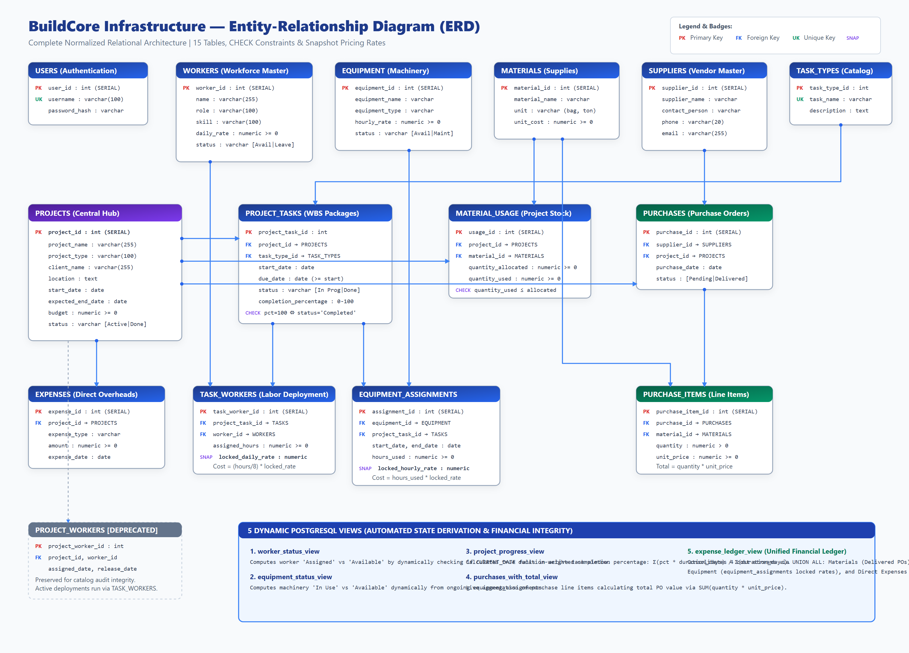

# BuildCore Infrastructure & Resource Governance Platform

[](https://www.postgresql.org/)
[](https://flask.palletsprojects.com/)
[](https://getbootstrap.com/)
[-059669?style=for-the-badge&logo=checkmarx&logoColor=white)](scratch/run_all_qa_tests.py)
[](templates/projects/)
[](BuildCore_ER_Diagram.svg)

> **BuildCore Infrastructure** is an enterprise-grade, web-based database management and resource governance platform engineered specifically for civil engineering, commercial construction, and infrastructure project operations. It transforms disconnected, error-prone spreadsheets into a strictly normalized, dynamically computed PostgreSQL relational database backed by an executive web application.

---

## 🎯 Strategic Aim & Software Evolution

Civil engineering projects routinely suffer from catastrophic cost overruns and scheduling delays caused by fragmented administrative tools. Generic project management software treats resources as abstract items, while basic database CRUD systems rely on vulnerable manual flags that quickly desynchronize from field operations.

BuildCore was designed and evolved with a clear purpose: **to provide an unbreakable, mathematically consistent single source of truth for construction resource management, site procurement, and cost accounting.**

```
+---------------------------------------------------------------------------------------------------+
|                                  THE 5 CONSTRUCTION FAILURE MODES                                 |
+------------------------------------+--------------------------------------------------------------+
| Traditional Vulnerability          | BuildCore Relational Solution                                |
+------------------------------------+--------------------------------------------------------------+
| 1. Desynchronized Availability     | Zero stored state flags; worker & equipment availability     |
|    (Workers marked 'Available'     | computed dynamically via SQL views from ongoing task dates.  |
|    while deployed on active sites) |                                                              |
| 2. Historical Cost Distortion      | Snapshot rate architecture locks daily & hourly rates at the |
|    (Master labor/machine price     | exact moment of assignment; past projects never inflate.     |
|    hikes alter old project ledger) |                                                              |
| 3. Cross-Project Material Leakage  | Strict project-isolated inventory (material_usage) capped by |
|    (One site consumes concrete     | kernel-level CHECK constraints (quantity_used <= allocated). |
|    allocated to another project)   |                                                              |
| 4. Fleet & Labor Over-Allocation   | Real-time temporal collision engine detects date overlaps    |
|    (Double-booking heavy machinery)| and prevents scheduling conflicts across active projects.    |
| 5. Skewed Milestone Metrics        | Duration-weighted progress view prevents short 1-day tasks   |
|    (5-min tasks skewing 90-day     | from artificially inflating overall project completion.      |
|    structural foundation metrics)  |                                                              |
+------------------------------------+--------------------------------------------------------------+
```

---

## 🏗️ The 6 Core Architectural Pillars

### 1. Project-First Command Center Paradigm
In real-world construction, equipment, labor, and materials do not operate in isolation—they exist strictly within the context of specific engineering projects. BuildCore organizes all operations through a **Project-First Hub**. Each project possesses a unified 7-tab command center:
1. **Overview**: Key metrics, high-contrast duration gauge, duration-weighted completion percentage, client/site metadata, and budget utilization.
2. **Tasks (WBS)**: Work Breakdown Structure tracking standardized task types, start/due dates, percentage completion, and status.
3. **Workers**: Certified workforce deployed to specific task activities with snapshot rate capture and active date tracking.
4. **Equipment**: Heavy machinery allocations (excavators, cranes, mixers) with logged hours and locked hourly rates.
5. **Materials**: Dedicated project-level inventory allocations ensuring zero inventory leakage across job sites.
6. **Purchases**: Master-detail procurement pipeline tracking purchase orders from vendors directly to the site.
7. **Financials**: Live 4-stream consolidated audit ledger combining materials, labor, machinery, and operational overheads.

### 2. Mathematical State Derivation (Zero Desynchronization)
BuildCore eliminates stored resource state flags. Instead of error-prone application-level updates (which fail during network interruptions, exceptions, or crashes), **resource availability is derived at query time by the PostgreSQL engine** via `worker_status_view` and `equipment_status_view`. If a worker's assigned task reaches its due date or is marked completed, their availability immediately shifts from `Assigned` to `Available` across the entire enterprise.

### 3. Temporal Scheduling Intelligence & Collision Engine
Physical assets cannot occupy two places simultaneously. BuildCore's collision detection engine analyzes requested assignment date ranges against all existing commitments across all concurrent projects, warning managers and blocking conflicting assignments before they reach the database.

### 4. Immutable Snapshot Rate Accounting
Master catalog prices change continuously due to market inflation, fuel costs, and revised union contracts. BuildCore preserves historical financial fidelity:
- When a worker is assigned, their current `daily_rate` is copied into `task_workers.locked_daily_rate`.
- When heavy equipment is deployed, its current `hourly_rate` is copied into `equipment_assignments.locked_hourly_rate`.
- Even if a machine's master rate doubles next year, all past projects retain their original, audited costs.

### 5. Accrual-Based Procurement & Site Inventory Isolation
Procurement follows standard civil construction accounting rules:
- Purchase orders created via `purchases` and `purchase_items` remain off the project expense ledger while in `Pending` or `Ordered` status.
- Once marked `Delivered` or `Completed`, materials immediately populate site-level inventory (`material_usage`) and automatically accrue to the project expense ledger.
- The PostgreSQL kernel enforces `CHECK (quantity_used <= quantity_allocated)`, making site over-consumption impossible.

### 6. High-Visibility Executive UI & Ergonomics
- **Royal Blue Enterprise Palette**: Cohesive, professional color hierarchy (`#1e3a8a`, `#2563eb`) paired with crisp elevation styling.
- **High-Contrast Metrics**: Large numeric KPIs, progress meters, and financial ledgers styled in deep black (`#0f172a`) on pure white surfaces for maximum legibility in lecture halls and construction site trailers.
- **Semantic Badging**: Instant visual distinction across operational states (Green: Available/Completed, Amber: In Progress/Assigned, Blue: Active/Ordered, Red: Maintenance/Leave).

---

## 📊 Complete Database Architecture & ER Diagram



> **Ready-to-Use Presentation & Slide Assets**:
> - **PowerPoint Slide Image (3200 × 2300 Ultra-HD PNG)**: [`BuildCore_ER_Diagram.png`](BuildCore_ER_Diagram.png) &mdash; High-resolution asset optimized for slide decks and large screens.
> - **Scalable Vector Graphic (Infinitely Zoomable SVG)**: [`BuildCore_ER_Diagram.svg`](BuildCore_ER_Diagram.svg) &mdash; Lossless vector format for printing or deep zoom inspection.
> - **Technical Architecture & Learning Guide (PDF)**: [`BuildCore_Architecture_and_Learning_Guide.pdf`](BuildCore_Architecture_and_Learning_Guide.pdf) &mdash; 3.5 MB comprehensive PDF guide covering the complete schema, SQL views, and viva defense guide.

### Formal Mermaid Schema Specification

```mermaid
erDiagram
    USERS {
        int user_id PK
        varchar username UK
        varchar password_hash
    }
    PROJECTS {
        int project_id PK
        varchar project_name
        varchar project_type
        varchar client_name
        text location
        date start_date
        date expected_end_date
        numeric budget "CHECK >= 0"
        varchar status "Planning | Active | On Hold | Completed"
    }
    WORKERS {
        int worker_id PK
        varchar name
        varchar role
        varchar skill
        varchar phone
        numeric daily_rate "CHECK >= 0"
        varchar status "Available | On Leave | Inactive"
    }
    EQUIPMENT {
        int equipment_id PK
        varchar equipment_name
        varchar equipment_type
        varchar status "Available | Maintenance | Retired"
        numeric hourly_rate "CHECK >= 0"
    }
    MATERIALS {
        int material_id PK
        varchar material_name
        varchar unit
        numeric unit_cost "CHECK >= 0"
    }
    SUPPLIERS {
        int supplier_id PK
        varchar supplier_name
        varchar contact_person
        varchar phone
        varchar email
        text address
    }
    TASK_TYPES {
        int task_type_id PK
        varchar task_name UK
        text description
    }
    PROJECT_TASKS {
        int project_task_id PK
        int project_id FK "ON DELETE CASCADE"
        int task_type_id FK "ON DELETE RESTRICT"
        date start_date
        date due_date "CHECK due_date >= start_date"
        varchar status "Not Started | In Progress | On Hold | Completed"
        numeric completion_percentage "CHECK 0 to 100"
        text description
    }
    TASK_WORKERS {
        int task_worker_id PK
        int project_task_id FK "ON DELETE CASCADE"
        int worker_id FK "ON DELETE CASCADE"
        numeric assigned_hours "CHECK >= 0"
        numeric locked_daily_rate "Snapshot Rate (CHECK >= 0)"
    }
    EQUIPMENT_ASSIGNMENTS {
        int assignment_id PK
        int equipment_id FK "ON DELETE CASCADE"
        int project_task_id FK "ON DELETE CASCADE"
        date start_date
        date end_date "CHECK end_date >= start_date"
        numeric hours_used "CHECK >= 0"
        numeric locked_hourly_rate "Snapshot Rate (CHECK >= 0)"
    }
    MATERIAL_USAGE {
        int usage_id PK
        int project_id FK "ON DELETE CASCADE"
        int material_id FK "ON DELETE CASCADE"
        numeric quantity_allocated "CHECK >= 0"
        numeric quantity_used "CHECK quantity_used <= quantity_allocated"
    }
    PURCHASES {
        int purchase_id PK
        int supplier_id FK "ON DELETE RESTRICT"
        int project_id FK "ON DELETE CASCADE"
        date purchase_date
        varchar status "Pending | Ordered | Delivered | Completed"
    }
    PURCHASE_ITEMS {
        int purchase_item_id PK
        int purchase_id FK "ON DELETE CASCADE"
        int material_id FK "ON DELETE RESTRICT"
        numeric quantity "CHECK > 0"
        numeric unit_price "CHECK >= 0"
    }
    EXPENSES {
        int expense_id PK
        int project_id FK "ON DELETE CASCADE"
        varchar expense_type
        numeric amount "CHECK >= 0"
        date expense_date
        text description
    }
    PROJECT_WORKERS {
        int project_worker_id PK
        int project_id FK "ON DELETE CASCADE"
        int worker_id FK "ON DELETE CASCADE"
        date assigned_date
        date release_date
        varchar role_on_project "DEPRECATED (Catalog Audit)"
    }

    PROJECTS ||--o{ PROJECT_TASKS : "contains (1:N)"
    TASK_TYPES ||--o{ PROJECT_TASKS : "instantiated_as (1:N)"
    PROJECT_TASKS ||--o{ TASK_WORKERS : "allocates (1:N)"
    WORKERS ||--o{ TASK_WORKERS : "assigned_to (1:N)"
    PROJECT_TASKS ||--o{ EQUIPMENT_ASSIGNMENTS : "utilizes (1:N)"
    EQUIPMENT ||--o{ EQUIPMENT_ASSIGNMENTS : "deployed_to (1:N)"
    PROJECTS ||--o{ MATERIAL_USAGE : "allocates_inventory (1:N)"
    MATERIALS ||--o{ MATERIAL_USAGE : "stocked_in (1:N)"
    SUPPLIERS ||--o{ PURCHASES : "fulfills (1:N)"
    PROJECTS ||--o{ PURCHASES : "orders_for (1:N)"
    PURCHASES ||--o{ PURCHASE_ITEMS : "contains_items (1:N)"
    MATERIALS ||--o{ PURCHASE_ITEMS : "procured_as (1:N)"
    PROJECTS ||--o{ EXPENSES : "incurs (1:N)"
    PROJECTS ||--o{ PROJECT_WORKERS : "legacy_macro_records (1:N)"
    WORKERS ||--o{ PROJECT_WORKERS : "legacy_records (1:N)"
```



---

## 📐 Relational Schema Specification (15 Tables)

The database schema is partitioned into **4 logical tiers**:

| Table | Primary Key | Foreign Keys | Key Constraints & Integrity Rules | Tier & Purpose |
| :--- | :--- | :--- | :--- | :--- |
| **`users`** | `user_id` | *None* | `username` is UNIQUE; Salted password hash via Werkzeug. | **Security**: Authentication & Session Governance. |
| **`projects`** | `project_id` | *None* | `CHECK (expected_end_date >= start_date)`, `CHECK (budget >= 0)`. | **Core Hub**: Central project entity governing all child resources. |
| **`workers`** | `worker_id` | *None* | `CHECK (daily_rate >= 0)`. Macro status: `Available`, `On Leave`, `Inactive`. | **Master Catalog**: Enterprise workforce repository. |
| **`equipment`** | `equipment_id` | *None* | `CHECK (hourly_rate >= 0)`. Macro status: `Available`, `Maintenance`, `Retired`. | **Master Catalog**: Enterprise fleet & machinery repository. |
| **`materials`** | `material_id` | *None* | `CHECK (unit_cost >= 0)`. Stores unit of measure (bags, tons, meters). | **Master Catalog**: Master construction supplies catalog. |
| **`suppliers`** | `supplier_id` | *None* | Vendor master repository with contact person, phone, email, and address. | **Master Catalog**: Authorized vendor directory. |
| **`task_types`** | `task_type_id` | *None* | `task_name` is UNIQUE (reusable standardized activity templates). | **Master Catalog**: Standard Work Breakdown dictionary. |
| **`project_tasks`** | `project_task_id` | `project_id` (CASCADE), `task_type_id` (RESTRICT) | `UNIQUE (project_id, task_type_id)`, `CHECK (due_date >= start_date)`, `CHECK (completion_percentage BETWEEN 0 AND 100)`. Task consistency: `status = 'Completed' <-> 100%`, `status = 'Not Started' -> 0%`. | **WBS Instance**: Discrete engineering task packages. |
| **`task_workers`** | `task_worker_id` | `project_task_id` (CASCADE), `worker_id` (CASCADE) | `CHECK (assigned_hours >= 0)`, `CHECK (locked_daily_rate >= 0)`. Snapshot rate captures labor rate at allocation moment. | **Junction Bridge**: Task labor deployments with snapshot pricing. |
| **`equipment_assignments`** | `assignment_id` | `equipment_id` (CASCADE), `project_task_id` (CASCADE) | `CHECK (end_date IS NULL OR end_date >= start_date)`, `CHECK (hours_used >= 0)`, `CHECK (locked_hourly_rate >= 0)`. | **Junction Bridge**: Machinery usage logging with locked hourly rates. |
| **`material_usage`** | `usage_id` | `project_id` (CASCADE), `material_id` (CASCADE) | `UNIQUE (project_id, material_id)`, `CHECK (quantity_used <= quantity_allocated)`, `CHECK (quantity_allocated >= 0)`. | **Junction Bridge**: Strict site-isolated inventory allocation. |
| **`purchases`** | `purchase_id` | `supplier_id` (RESTRICT), `project_id` (CASCADE) | Master purchase record. Status: `Pending`, `Ordered`, `Delivered`, `Completed`. Accrual on `Delivered`/`Completed`. | **Procurement**: Purchase order headers linked to projects. |
| **`purchase_items`** | `purchase_item_id` | `purchase_id` (CASCADE), `material_id` (RESTRICT) | `CHECK (quantity > 0)`, `CHECK (unit_price >= 0)`. Line-item details calculating item total: `quantity * unit_price`. | **Procurement**: Itemized purchase order line items. |
| **`expenses`** | `expense_id` | `project_id` (CASCADE) | `CHECK (amount >= 0)`. Tracks operational, legal, permit, and miscellaneous direct site overheads. | **Financials**: Direct miscellaneous project expense records. |
| **`project_workers`** | `project_worker_id` | `project_id` (CASCADE), `worker_id` (CASCADE) | **[DEPRECATED]** Legacy macro junction table preserved for PostgreSQL catalog audit integrity. Active deployments run via `task_workers`. | **Audit Archive**: Historical macro catalog audit trail. |

---

## ⚡ Dynamic SQL Views & Automated Business Logic

BuildCore shifts complex business logic from fragile application code directly into **5 High-Performance PostgreSQL Views**:

### 1. `worker_status_view` (Automated Workforce Availability)
```sql
CREATE OR REPLACE VIEW worker_status_view AS
SELECT w.*,
    CASE 
        WHEN w.status IN ('On Leave', 'Inactive') THEN w.status
        WHEN EXISTS (
            SELECT 1 FROM task_workers tw
            JOIN project_tasks pt ON tw.project_task_id = pt.project_task_id
            WHERE tw.worker_id = w.worker_id
              AND pt.status = 'In Progress'
              AND CURRENT_DATE BETWEEN pt.start_date AND pt.due_date
        ) THEN 'Assigned'
        ELSE 'Available'
    END AS computed_status
FROM workers w;
```
*Guarantees a worker is only marked 'Assigned' when actively deployed to an ongoing task whose date window encompasses today.*

### 2. `equipment_status_view` (Automated Equipment Allocation)
```sql
CREATE OR REPLACE VIEW equipment_status_view AS
SELECT e.*,
    CASE 
        WHEN e.status IN ('Maintenance', 'Retired') THEN e.status
        WHEN EXISTS (
            SELECT 1 FROM equipment_assignments ea
            JOIN project_tasks pt ON ea.project_task_id = pt.project_task_id
            WHERE ea.equipment_id = e.equipment_id
              AND ea.start_date <= CURRENT_DATE 
              AND (
                  (ea.end_date IS NOT NULL AND ea.end_date >= CURRENT_DATE)
                  OR (ea.end_date IS NULL AND pt.status != 'Completed' AND (pt.due_date IS NULL OR pt.due_date >= CURRENT_DATE))
              )
        ) THEN 'In Use'
        ELSE 'Available'
    END AS computed_status
FROM equipment e;
```
*Computes machinery allocation state automatically from ongoing assignment intervals.*

### 3. `project_progress_view` (Duration-Weighted Project Progress)
```sql
CREATE OR REPLACE VIEW project_progress_view AS
SELECT 
    p.project_id,
    p.project_name,
    COALESCE(
        SUM(pt.completion_percentage * (pt.due_date - pt.start_date + 1)) / 
        NULLIF(SUM(pt.due_date - pt.start_date + 1), 0), 0
    ) AS progress_percentage,
    COUNT(pt.project_task_id) AS total_tasks,
    SUM(CASE WHEN pt.status = 'Completed' THEN 1 ELSE 0 END) AS completed_tasks
FROM projects p
LEFT JOIN project_tasks pt ON p.project_id = pt.project_id
GROUP BY p.project_id;
```
*Calculates true duration-weighted project completion ($\sum(\text{pct} \times \text{days}) / \sum(\text{days})$), preventing minor short-duration tasks from skewing major structural engineering deliverables.*

### 4. `purchases_with_total_view` (Live Procurement Valuation)
```sql
CREATE OR REPLACE VIEW purchases_with_total_view AS
SELECT 
    p.purchase_id, p.supplier_id, p.project_id, p.purchase_date, p.status,
    COALESCE(SUM(pi.quantity * pi.unit_price), 0) AS total_amount
FROM purchases p
LEFT JOIN purchase_items pi ON p.purchase_id = pi.purchase_id
GROUP BY p.purchase_id;
```
*Aggregates line items in real time to calculate total purchase order value.*

### 5. `expense_ledger_view` (Unified 4-Stream Cost Ledger)
Consolidates all project expenses into a single immutable audit stream using `UNION ALL`:
- **Delivered Materials**: `ROUND(quantity * unit_price, 2)` from `purchase_items` WHERE `status IN ('Delivered', 'Completed')`.
- **Deployed Labor**: `ROUND((assigned_hours / 8.0) * locked_daily_rate, 2)` from `task_workers`.
- **Equipment Hours**: `ROUND(hours_used * locked_hourly_rate, 2)` from `equipment_assignments`.
- **Direct Overheads**: Direct records from `expenses`.

---

## 🛡️ Enterprise Integrity & Hardening Features

1. **Snapshot Rate Protection**: Labor daily rates and machinery hourly rates are frozen at assignment creation, insulating project P&L from future catalog adjustments.
2. **Strict Project Material Isolation**: Unique constraint `UNIQUE (project_id, material_id)` isolates site inventory; materials cannot be depleted across project boundaries.
3. **Kernel-Enforced Consistency Constraints**:
   - `check_task_completion_status`: Progress = 100% $\iff$ status is 'Completed'.
   - `check_task_not_started_percentage`: Status = 'Not Started' $\implies$ progress must be 0%.
   - `check_material_usage_limit`: `quantity_used <= quantity_allocated`.
   - `check_dates`: Start date $\le$ Due/End date across projects, tasks, and machinery assignments.
4. **History Protection Guard**: Prohibits deletion of projects that carry active purchase orders or financial audit records.
5. **Interactive Collision Prevention Modals**: Form inputs validate overlapping date ranges against the database, alerting managers before conflicting records can be inserted.
6. **Direct SQL Execution via `text()`**: BuildCore deliberately uses parameterized raw SQL queries (`db.session.execute(text(...))`), demonstrating mastery of SQL joins, CTEs, window functions, and transaction semantics while safeguarding against SQL injection.

---

## 🧪 Comprehensive QA Verification Suite

BuildCore includes an automated test framework covering **9 adversarial validation modules** (`scratch/run_all_qa_tests.py`):

```
========================================================================================
                          BUILDCORE QA VERIFICATION REPORT                              
========================================================================================
[PASS] 1. Material Allocation & Usage Isolation (uq_project_material, cap checks)
[PASS] 2. Snapshot Rate Accounting & Unified Expense Ledger (locked rates, UNION ALL)
[PASS] 3. Dynamic Availability Views (worker_status_view, equipment_status_view)
[PASS] 4. Task Progress & Status Synchronization (100% <-> Completed, Not Started -> 0%)
[PASS] 5. History Protection & Referential Integrity (RESTRICT on active POs)
[PASS] 6. Enterprise Scale & Multi-Task Work Breakdown Load
[PASS] 7. Security, Salted Authentication & SQL Injection Parameterization
[PASS] 8. Duration-Weighted Progress Accuracy (project_progress_view)
[PASS] 9. Project-First UI Route Introspection & Collision Modals
========================================================================================
RESULT: 100% TEST SUITE PASS RATE (0 FAILURES, 0 REGRESSIONS)
========================================================================================
```

---

## 🚀 Local Installation & Setup

### 1. Prerequisites
- **Python**: 3.10 or higher
- **PostgreSQL**: 14 or higher

### 2. Clone Repository & Setup Virtual Environment
```bash
git clone https://github.com/ishan-awas-13/buildcore-construction-manager.git
cd buildcore-construction-manager

python -m venv venv
# Windows:
.\venv\Scripts\activate
# Linux/macOS:
source venv/bin/activate
```

### 3. Install Dependencies
```bash
pip install -r requirements.txt
```

### 4. Configure Environment Variables
Create a `.env` file in the project root:
```env
DB_USER=postgres
DB_PASSWORD=your_postgres_password
DB_HOST=127.0.0.1
DB_PORT=5432
DB_NAME=buildcore_copy
SECRET_KEY=your_secure_random_key
```

### 5. Initialize Schema & Seed Data
```bash
python setup_db.py
flask create-admin
```

### 6. Run the Application
```bash
flask run --debug
```
Access the application at `http://127.0.0.1:5000`.

### 7. Run Test Verification Suite
```bash
python scratch/run_all_qa_tests.py
```

---

## 🎓 Academic Defense & Presentation Resources

For academic evaluations, project demonstrations, and viva defense:
- **Presentation Walkthrough & Script**: [`FINAL_PRESENTATION_WALKTHROUGH.md`](FINAL_PRESENTATION_WALKTHROUGH.md) &mdash; Detailed step-by-step presentation script with split-screen parallel `psql` queries proving that UI actions immediately update the PostgreSQL backend (not cached in browser).
- **Architecture & Learning Guide**: [`BUILDCORE_ARCHITECTURE_AND_LEARNING_GUIDE.md`](BUILDCORE_ARCHITECTURE_AND_LEARNING_GUIDE.md) &mdash; 50 KB complete technical and theoretical study guide covering normalization (1NF through BCNF), transaction isolation, indexing strategies, 12-slide PPT outline, and 15 viva questions with model answers.
- **Publication PDF Guide**: [`BuildCore_Architecture_and_Learning_Guide.pdf`](BuildCore_Architecture_and_Learning_Guide.pdf) &mdash; Ready-to-study 3.5 MB compiled document featuring the embedded visual ER diagram.
- **Presentation Slide Graphics**: [`BuildCore_ER_Diagram.png`](BuildCore_ER_Diagram.png) (3200×2300 4K PNG) and [`BuildCore_ER_Diagram.svg`](BuildCore_ER_Diagram.svg) (lossless vector).

---

## 👥 Contributors & Academic Context

- **Course**: Database Systems (Semester 5)
- **Project**: BuildCore Infrastructure & Construction Management System
- **Repository**: [ishan-awas-13/buildcore-construction-manager](https://github.com/ishan-awas-13/buildcore-construction-manager)
