# BuildCore Infrastructure & Resource Manager

[](https://www.postgresql.org/)
[](https://flask.palletsprojects.com/)
[](https://getbootstrap.com/)
[](scratch/run_all_qa_tests.py)
[](templates/projects/)

**BuildCore Infrastructure** is an enterprise-grade, web-based database management system designed specifically for civil engineering and construction resource governance. It replaces fragile, disconnected spreadsheets with a strictly normalized, dynamically computed PostgreSQL relational database accessed through a modern, responsive web application.

---

## 🏗️ Architectural Overview (Project-First Paradigm)

BuildCore organizes construction operations through a **Project-First Architecture**. In real-world engineering, equipment, labor, and materials do not exist in isolation—they operate in the context of specific projects and work breakdown tasks.

The system features:
- **Unified Project Workspaces**: Dedicated 7-tab command centers per project (**Overview, Tasks, Workers, Equipment, Materials, Purchases, Financials**).
- **Automated Dynamic Status Calculation**: Resource availability for Workers and Equipment is calculated directly through PostgreSQL views (`worker_status_view`, `equipment_status_view`). It is mathematically impossible for resource states to become desynchronized or "stuck".
- **Real-Time Collision Prevention**: Interactive scheduling intelligence that detects date overlaps across concurrent tasks and prevents double-booking.
- **Snapshot Rate Financial Integrity**: Locks labor daily rates (`locked_daily_rate`) and equipment hourly rates (`locked_hourly_rate`) at assignment time to safeguard historical cost ledgers against future master-rate inflation.
- **Master-Detail Procurement Pipeline**: Project-isolated purchasing (`purchases` & `purchase_items`) linking directly to project-level inventory (`material_usage`) and financial ledger tracking (`expense_ledger_view`).
- **Database Engine Check Constraints**: Enforces business rules in the PostgreSQL kernel (e.g. task progress synchronization, date boundary validation, non-negative budget/rates, and material usage caps).

---

## 📊 Complete Database Architecture (Entity-Relationship Diagram)

The following Mermaid diagram illustrates the complete relational schema of the BuildCore database, detailing primary keys, foreign keys, junction tables, and relational cardinalities:

```mermaid
erDiagram
    USERS {
        int user_id PK
        varchar username UK
        varchar password_hash
    }
    PROJECTS {
        int project_id PK
        varchar project_name
        varchar project_type
        varchar client_name
        text location
        date start_date
        date expected_end_date
        numeric budget "CHECK >= 0"
        varchar status "Planning | Active | On Hold | Completed"
    }
    WORKERS {
        int worker_id PK
        varchar name
        varchar role
        varchar skill
        varchar phone
        numeric daily_rate "CHECK >= 0"
        varchar status "Available | On Leave | Inactive"
    }
    EQUIPMENT {
        int equipment_id PK
        varchar equipment_name
        varchar equipment_type
        varchar status "Available | Maintenance | Retired"
        numeric hourly_rate "CHECK >= 0"
    }
    MATERIALS {
        int material_id PK
        varchar material_name
        varchar unit
        numeric unit_cost "CHECK >= 0"
    }
    SUPPLIERS {
        int supplier_id PK
        varchar supplier_name
        varchar contact_person
        varchar phone
        varchar email
        text address
    }
    TASK_TYPES {
        int task_type_id PK
        varchar task_name UK
        text description
    }
    PROJECT_TASKS {
        int project_task_id PK
        int project_id FK "ON DELETE CASCADE"
        int task_type_id FK "ON DELETE RESTRICT"
        date start_date
        date due_date "CHECK due_date >= start_date"
        varchar status "Not Started | In Progress | On Hold | Completed"
        numeric completion_percentage "CHECK 0 to 100"
        text description
    }
    TASK_WORKERS {
        int task_worker_id PK
        int project_task_id FK "ON DELETE CASCADE"
        int worker_id FK "ON DELETE CASCADE"
        numeric assigned_hours "CHECK >= 0"
        numeric locked_daily_rate "Snapshot Rate (CHECK >= 0)"
    }
    EQUIPMENT_ASSIGNMENTS {
        int assignment_id PK
        int equipment_id FK "ON DELETE CASCADE"
        int project_task_id FK "ON DELETE CASCADE"
        date start_date
        date end_date "CHECK end_date >= start_date"
        numeric hours_used "CHECK >= 0"
        numeric locked_hourly_rate "Snapshot Rate (CHECK >= 0)"
    }
    MATERIAL_USAGE {
        int usage_id PK
        int project_id FK "ON DELETE CASCADE"
        int material_id FK "ON DELETE CASCADE"
        numeric quantity_allocated "CHECK >= 0"
        numeric quantity_used "CHECK quantity_used <= quantity_allocated"
    }
    PURCHASES {
        int purchase_id PK
        int supplier_id FK "ON DELETE RESTRICT"
        int project_id FK "ON DELETE CASCADE"
        date purchase_date
        varchar status "Pending | Ordered | Delivered | Completed"
    }
    PURCHASE_ITEMS {
        int purchase_item_id PK
        int purchase_id FK "ON DELETE CASCADE"
        int material_id FK "ON DELETE RESTRICT"
        numeric quantity "CHECK > 0"
        numeric unit_price "CHECK >= 0"
    }
    EXPENSES {
        int expense_id PK
        int project_id FK "ON DELETE CASCADE"
        varchar expense_type
        numeric amount "CHECK >= 0"
        date expense_date
        text description
    }
    PROJECT_WORKERS {
        int project_worker_id PK
        int project_id FK "ON DELETE CASCADE"
        int worker_id FK "ON DELETE CASCADE"
        date assigned_date
        date release_date
        varchar role_on_project "DEPRECATED (Catalog Audit)"
    }

    PROJECTS ||--o{ PROJECT_TASKS : "contains (1:N)"
    TASK_TYPES ||--o{ PROJECT_TASKS : "instantiated_as (1:N)"
    PROJECT_TASKS ||--o{ TASK_WORKERS : "allocates (1:N)"
    WORKERS ||--o{ TASK_WORKERS : "assigned_to (1:N)"
    PROJECT_TASKS ||--o{ EQUIPMENT_ASSIGNMENTS : "utilizes (1:N)"
    EQUIPMENT ||--o{ EQUIPMENT_ASSIGNMENTS : "deployed_to (1:N)"
    PROJECTS ||--o{ MATERIAL_USAGE : "allocates_inventory (1:N)"
    MATERIALS ||--o{ MATERIAL_USAGE : "stocked_in (1:N)"
    SUPPLIERS ||--o{ PURCHASES : "fulfills (1:N)"
    PROJECTS ||--o{ PURCHASES : "orders_for (1:N)"
    PURCHASES ||--o{ PURCHASE_ITEMS : "contains_items (1:N)"
    MATERIALS ||--o{ PURCHASE_ITEMS : "procured_as (1:N)"
    PROJECTS ||--o{ EXPENSES : "incurs (1:N)"
    PROJECTS ||--o{ PROJECT_WORKERS : "legacy_macro_records (1:N)"
    WORKERS ||--o{ PROJECT_WORKERS : "legacy_records (1:N)"
```



---

## 📐 Relational Schema Specification

| Table | Primary Key | Foreign Keys | Key Constraints & Integrity Rules |
| :--- | :--- | :--- | :--- |
| **`users`** | `user_id` | *None* | `username` is UNIQUE; Password stored as secure Werkzeug salt/hash. |
| **`projects`** | `project_id` | *None* | `CHECK (expected_end_date >= start_date)`, `CHECK (budget >= 0)`. |
| **`workers`** | `worker_id` | *None* | `CHECK (daily_rate >= 0)`. Status: `Available`, `On Leave`, `Inactive`. |
| **`equipment`** | `equipment_id` | *None* | `CHECK (hourly_rate >= 0)`. Status: `Available`, `Maintenance`, `Retired`. |
| **`materials`** | `material_id` | *None* | `CHECK (unit_cost >= 0)`. |
| **`suppliers`** | `supplier_id` | *None* | Vendor master repository with contact details. |
| **`task_types`** | `task_type_id` | *None* | `task_name` is UNIQUE (reusable activity templates). |
| **`project_tasks`** | `project_task_id` | `project_id` (CASCADE), `task_type_id` (RESTRICT) | `UNIQUE (project_id, task_type_id)`, `CHECK (due_date >= start_date)`, `CHECK (completion_percentage BETWEEN 0 AND 100)`. Task Consistency constraints: status `Completed` &harr; 100%, status `Not Started` &rarr; 0%. |
| **`task_workers`** | `task_worker_id` | `project_task_id` (CASCADE), `worker_id` (CASCADE) | `CHECK (assigned_hours >= 0)`, `CHECK (locked_daily_rate >= 0)`. Snapshot rate captures labor rate at assignment time. |
| **`equipment_assignments`** | `assignment_id` | `equipment_id` (CASCADE), `project_task_id` (CASCADE) | `CHECK (end_date IS NULL OR end_date >= start_date)`, `CHECK (hours_used >= 0)`, `CHECK (locked_hourly_rate >= 0)`. |
| **`material_usage`** | `usage_id` | `project_id` (CASCADE), `material_id` (CASCADE) | `UNIQUE (project_id, material_id)`, `CHECK (quantity_used <= quantity_allocated)`, `CHECK (quantity_allocated >= 0)`. Enforces strict project material isolation. |
| **`purchases`** | `purchase_id` | `supplier_id` (RESTRICT), `project_id` (CASCADE) | Master purchase record. Accrual recognition: materials become expenses upon `Delivered`/`Completed`. |
| **`purchase_items`** | `purchase_item_id` | `purchase_id` (CASCADE), `material_id` (RESTRICT) | `CHECK (quantity > 0)`, `CHECK (unit_price >= 0)`. Line-item details. |
| **`expenses`** | `expense_id` | `project_id` (CASCADE) | `CHECK (amount >= 0)`. Tracks miscellaneous/operational direct project overheads. |
| **`project_workers`** | `project_worker_id` | `project_id` (CASCADE), `worker_id` (CASCADE) | **[DEPRECATED]** Legacy macro junction table preserved for PostgreSQL catalog audit trails. Active task assignments run on `task_workers`. |

---

## ⚡ Dynamic SQL Views & Automated Business Logic

Rather than relying on error-prone application-level flags, BuildCore delegates state derivation to **5 PostgreSQL Views**:

### 1. `worker_status_view` (Automated Worker Availability)
```sql
CREATE OR REPLACE VIEW worker_status_view AS
SELECT w.*,
    CASE 
        WHEN w.status IN ('On Leave', 'Inactive') THEN w.status
        WHEN EXISTS (
            SELECT 1 FROM task_workers tw
            JOIN project_tasks pt ON tw.project_task_id = pt.project_task_id
            WHERE tw.worker_id = w.worker_id
              AND pt.status = 'In Progress'
              AND CURRENT_DATE BETWEEN pt.start_date AND pt.due_date
        ) THEN 'Assigned'
        ELSE 'Available'
    END AS computed_status
FROM workers w;
```
*Guarantees a worker is only marked 'Assigned' when actively deployed to an ongoing task.*

### 2. `equipment_status_view` (Automated Equipment Allocation)
```sql
CREATE OR REPLACE VIEW equipment_status_view AS
SELECT e.*,
    CASE 
        WHEN e.status IN ('Maintenance', 'Retired') THEN e.status
        WHEN EXISTS (
            SELECT 1 FROM equipment_assignments ea
            JOIN project_tasks pt ON ea.project_task_id = pt.project_task_id
            WHERE ea.equipment_id = e.equipment_id
              AND ea.start_date <= CURRENT_DATE 
              AND (
                  (ea.end_date IS NOT NULL AND ea.end_date >= CURRENT_DATE)
                  OR (ea.end_date IS NULL AND pt.status != 'Completed' AND (pt.due_date IS NULL OR pt.due_date >= CURRENT_DATE))
              )
        ) THEN 'In Use'
        ELSE 'Available'
    END AS computed_status
FROM equipment e;
```

### 3. `project_progress_view` (Duration-Weighted Project Progress)
```sql
CREATE OR REPLACE VIEW project_progress_view AS
SELECT 
    p.project_id,
    p.project_name,
    COALESCE(
        SUM(pt.completion_percentage * (pt.due_date - pt.start_date + 1)) / 
        NULLIF(SUM(pt.due_date - pt.start_date + 1), 0), 0
    ) AS progress_percentage,
    COUNT(pt.project_task_id) AS total_tasks,
    SUM(CASE WHEN pt.status = 'Completed' THEN 1 ELSE 0 END) AS completed_tasks
FROM projects p
LEFT JOIN project_tasks pt ON p.project_id = pt.project_id
GROUP BY p.project_id;
```
*Computes overall project progress weighted by task duration in days, preventing short 1-day tasks from distorting massive 6-month milestones.*

### 4. `purchases_with_total_view` (Live Procurement Totals)
```sql
CREATE OR REPLACE VIEW purchases_with_total_view AS
SELECT 
    p.purchase_id, p.supplier_id, p.project_id, p.purchase_date, p.status,
    COALESCE(SUM(pi.quantity * pi.unit_price), 0) AS total_amount
FROM purchases p
LEFT JOIN purchase_items pi ON p.purchase_id = pi.purchase_id
GROUP BY p.purchase_id;
```

### 5. `expense_ledger_view` (Unified 4-Stream Cost Ledger)
Consolidates all project expenses into a single audit stream using `UNION ALL`:
- **Materials**: `ROUND(quantity * unit_price, 2)` from `purchase_items` WHERE status IN ('Delivered', 'Completed').
- **Labor**: `ROUND((assigned_hours / 8.0) * locked_daily_rate, 2)` from `task_workers`.
- **Equipment**: `ROUND(hours_used * locked_hourly_rate, 2)` from `equipment_assignments`.
- **Other**: Direct entries from `expenses`.

---

## 🛡️ Enterprise Data Integrity & Hardening Features

1. **Snapshot Rate Accounting**: Labor and machinery costs use immutable rates recorded at allocation time.
2. **Project Material Isolation**: Material allocations are unique to projects (`uq_project_material`); inventory cannot leak across project boundaries.
3. **Database Check Constraints**:
   - `check_task_completion_status`: Tasks with 100% progress must be `Completed`; tasks `< 100%` cannot be marked `Completed`.
   - `check_task_not_started_percentage`: `Not Started` tasks cannot have progress `> 0%`.
4. **History Protection Guard**: Prevents accidental deletion of projects that carry active purchase orders or financial audit ledgers.
5. **Real-Time Interactive Collision Alerts**: Modals warn users and block form submission if assigning a worker or machine to an overlapping task date window.

---

## 🚀 Local Installation & Execution

### 1. Prerequisites
- Python 3.10+
- PostgreSQL 14+

### 2. Setup Virtual Environment
```bash
python -m venv venv
# Windows:
.\venv\Scripts\activate
# Linux/macOS:
source venv/bin/activate
```

### 3. Install Dependencies
```bash
pip install -r requirements.txt
```

### 4. Configure Environment
Create a `.env` file in the project root:
```env
DB_USER=postgres
DB_PASSWORD=your_password
DB_HOST=127.0.0.1
DB_PORT=5432
DB_NAME=buildcore_copy
SECRET_KEY=your_secret_key
```

### 5. Initialize Database & Seed
```bash
python setup_db.py
flask create-admin
```

### 6. Run Application
```bash
flask run --debug
```
Access the application at `http://127.0.0.1:5000`.

### 7. Run Comprehensive QA Test Suite
Verify 100% adversarial test pass rate across all 9 modules:
```bash
python scratch/run_all_qa_tests.py
```
