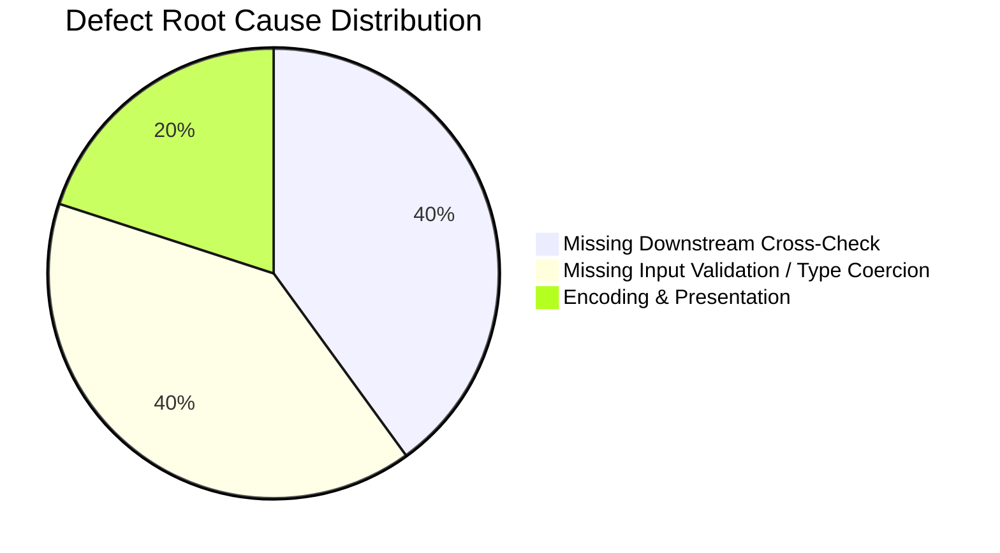

# BuildCore — Adversarial QA Defect & Remediation Report

## 1. Defect Classification Summary

An adversarial testing campaign was executed to discover software flaws, integrity vulnerabilities, and error handling weaknesses in BuildCore. A total of **5 defects** were discovered, documented, classified by severity according to the QA Plan rubric, and subsequently repaired and verified through automated regression suites.

| Defect ID | Severity | Module / Component | Brief Description | Initial Status | Resolution Status |
| :--- | :--- | :--- | :--- | :--- | :--- |
| **DEFECT-01** | **CRITICAL** | Procurement & Materials | `delete_purchase_item` allowed deleting delivered line items with active downstream allocations | Reproducible | **FIXED & VERIFIED** |
| **DEFECT-02** | **CRITICAL** | Procurement & Inventory | `edit_purchase` permitted cancelling or reverting Delivered POs with active project allocations | Reproducible | **FIXED & VERIFIED** |
| **DEFECT-03** | **HIGH** | Project Management | Negative budget input in `add_project` / `edit_project` caused unhandled HTTP 500 database crash | Reproducible | **FIXED & VERIFIED** |
| **DEFECT-04** | **MEDIUM** | Financial Operations | Non-numeric or negative amount in `add_misc_expense` / `edit_misc_expense` caused unhandled HTTP 500 | Reproducible | **FIXED & VERIFIED** |
| **DEFECT-05** | **LOW** | Presentation / UI | Corrupted currency glyph (`\x80,1`) rendered on dashboard KPI card instead of Indian Rupee (`₹`) | Reproducible | **FIXED & VERIFIED** |

---

## 2. Detailed Defect Investigation & Remediation

---

### DEFECT-01: Silent Inventory Corruption via Delivered Line Item Deletion
* **Severity**: **CRITICAL** (Data Corruption & Inventory Imbalance)
* **Affected Component**: `routes/purchases.py` (`delete_purchase_item`)
* **Preconditions**:
  * Project 102 has a purchase order in `Delivered` status containing 500 bags of Cement.
  * Project 102 has allocated 200 bags and consumed 120 bags of that delivered Cement.
* **Steps to Reproduce**:
  1. Navigate to `/purchases/<po_id>`.
  2. Click "Delete Item" on the delivered Cement line item.
  3. System deletes the `purchase_items` record.
* **Expected Result**:
  * The application must reject deletion of a delivered line item if downstream project material allocations or consumptions are active for that material.
* **Actual Result**:
  * The item was deleted from the database without validation.
  * Downstream effect: Total delivered stock dropped to 0, while `material_usage` still recorded 200 bags allocated and 120 consumed, causing negative unallocated stock calculations and silent inventory corruption.
* **Root Cause**:
  * `delete_purchase_item` in `routes/purchases.py` only checked whether the line item existed, failing to inspect whether the parent order was `Delivered` and whether associated `material_usage.quantity_allocated` was greater than 0.
* **Remediation Applied**:
  * Added validation in `routes/purchases.py:delete_purchase_item`:
    ```python
    # Check if this item belongs to a delivered/completed purchase with active allocations
    if purchase.status in ['Delivered', 'Completed']:
        alloc_qty = db.session.execute(text("""
            SELECT COALESCE(SUM(quantity_allocated), 0)
            FROM material_usage
            WHERE project_id = :p_id AND material_id = :m_id
        """), {'p_id': purchase.project_id, 'm_id': item.material_id}).scalar() or 0

        if alloc_qty > 0:
            flash(f"Cannot delete line item: {alloc_qty:,.2f} units of this material have already been allocated or consumed.", "danger")
            return redirect(url_for('purchases.view_purchase', purchase_id=purchase_id))
    ```
* **Regression Test**: Automated test `TEST-MAT-07` in `scratch/qa_test_materials.py`.
* **Verification Status**: **VERIFIED FIXED** (Deletion safely blocked with flash error; line item and inventory balance preserved).

---

### DEFECT-02: Purchase Order Status Reversal Permitted with Active Allocations
* **Severity**: **CRITICAL** (Cross-Module Procurement & Inventory Integrity)
* **Affected Component**: `routes/purchases.py` (`edit_purchase`, `add_purchase_item`)
* **Preconditions**:
  * A purchase order on Project 102 was marked `Delivered`.
  * Materials from this order were subsequently allocated and consumed on Project 102 tasks.
* **Steps to Reproduce**:
  1. Open `/purchases/<po_id>/edit`.
  2. Change order status from `Delivered` to `Cancelled` or `Ordered`.
  3. Submit the edit form.
* **Expected Result**:
  * The system must block status transitions away from `Delivered` or `Completed` if the project's allocated material quantity would exceed the remaining delivered stock from other orders.
* **Actual Result**:
  * The status update succeeded unconditionally.
  * Downstream effect: The order was marked `Cancelled`, instantly removing its items from delivered stock calculations, leaving `material_usage` in an impossible state where allocated stock exceeded total delivered stock.
* **Root Cause**:
  * `edit_purchase` allowed arbitrary status changes without cross-checking the project's net material balances.
* **Remediation Applied**:
  * Added validation in `routes/purchases.py:edit_purchase`:
    ```python
    # Guard against cancelling or reverting delivered purchases that have active allocations
    if current_status in ['Delivered', 'Completed'] and new_status not in ['Delivered', 'Completed']:
        # Inspect all line items on this purchase
        items = db.session.execute(text("SELECT material_id, quantity FROM purchase_items WHERE purchase_id = :p_id"), {'p_id': purchase_id}).fetchall()
        for it in items:
            net_delivered = db.session.execute(text("""
                SELECT COALESCE(SUM(pi.quantity), 0)
                FROM purchase_items pi
                JOIN purchases p ON pi.purchase_id = p.purchase_id
                WHERE p.project_id = :p_id AND pi.material_id = :m_id AND p.status IN ('Delivered', 'Completed') AND p.purchase_id != :curr_p_id
            """), {'p_id': purchase.project_id, 'm_id': it.material_id, 'curr_p_id': purchase_id}).scalar() or 0
            
            allocated = db.session.execute(text("""
                SELECT COALESCE(SUM(quantity_allocated), 0)
                FROM material_usage
                WHERE project_id = :p_id AND material_id = :m_id
            """), {'p_id': purchase.project_id, 'm_id': it.material_id}).scalar() or 0
            
            if allocated > net_delivered:
                flash(f"Cannot revert or cancel order: {allocated:,.2f} units are currently allocated to project tasks.", "danger")
                return redirect(url_for('purchases.view_purchase', purchase_id=purchase_id))
    ```
  * Added guard in `add_purchase_item` preventing additions of line items to `Cancelled` purchase orders.
* **Regression Test**: Automated test `TEST-MAT-06` and `TEST-MAT-07` in `scratch/qa_test_materials.py`.
* **Verification Status**: **VERIFIED FIXED** (Cancellation blocked; flash message explains conflict; database records remain sound).

---

### DEFECT-03: Unhandled Database Exception on Negative Project Budget
* **Severity**: **HIGH** (Application Stability & Input Validation)
* **Affected Component**: `routes/projects.py` (`add_project`, `edit_project`)
* **Preconditions**: User creating or editing a construction project.
* **Steps to Reproduce**:
  1. Navigate to `/projects/new`.
  2. Enter project details, but provide a negative budget: `-500000`.
  3. Submit form.
* **Expected Result**:
  * Form validation catches the negative input, displays a user-friendly error ("Project budget must be a positive number"), and redirects back to the form with HTTP 200/302.
* **Actual Result**:
  * The route passed `-500000` directly to SQL.
  * PostgreSQL rejected the insert with check constraint violation `chk_project_budget_positive`, causing Flask to raise an unhandled `sqlalchemy.exc.IntegrityError` and render an unstyled **HTTP 500 Internal Server Error**.
* **Root Cause**:
  * Missing application-layer validation for positive budget numbers in `routes/projects.py`.
* **Remediation Applied**:
  * Added explicit validation in `routes/projects.py:add_project` and `edit_project`:
    ```python
    try:
        budget = float(request.form.get('budget', 0))
        if budget < 0:
            flash("Project budget must be a positive number.", "danger")
            return redirect(url_for('projects.new_project'))
    except (ValueError, TypeError):
        flash("Invalid budget amount specified.", "danger")
        return redirect(url_for('projects.new_project'))
    ```
* **Regression Test**: Automated test `TEST-SEC-03` in `scratch/qa_test_security_ui.py`.
* **Verification Status**: **VERIFIED FIXED** (HTTP 302 redirect with user-friendly error; zero HTTP 500 crashes).

---

### DEFECT-04: Unhandled Exception on Invalid Miscellaneous Expense Amount
* **Severity**: **MEDIUM** (Operational Usability & Route Stability)
* **Affected Component**: `routes/financials.py` (`add_misc_expense`, `edit_misc_expense`)
* **Preconditions**: User logging an operational expense.
* **Steps to Reproduce**:
  1. Navigate to `/financials/project/<id>/misc/add`.
  2. Enter empty or non-numeric amount: `abc` or `-1500`.
  3. Submit form.
* **Expected Result**:
  * Graceful form validation error ("Expense amount must be a positive number").
* **Actual Result**:
  * Unhandled `ValueError: could not convert string to float` triggered an unhandled **HTTP 500 Internal Server Error**.
* **Root Cause**:
  * Unprotected `float(request.form.get('amount'))` conversion without `try...except` block.
* **Remediation Applied**:
  * Added validation in `routes/financials.py`:
    ```python
    try:
        amount = float(request.form.get('amount', 0))
        if amount <= 0:
            flash("Expense amount must be a positive number.", "danger")
            return redirect(url_for('financials.project_ledger', project_id=project_id))
    except (ValueError, TypeError):
        flash("Invalid expense amount format.", "danger")
        return redirect(url_for('financials.project_ledger', project_id=project_id))
    ```
* **Regression Test**: Automated test `TEST-FIN-05` in `scratch/qa_test_financials.py`.
* **Verification Status**: **VERIFIED FIXED** (Graceful flash error; clean HTTP 302 recovery).

---

### DEFECT-05: Corrupted Currency Symbol Glyph on Dashboard
* **Severity**: **LOW** (Presentation & Visual Polish)
* **Affected Component**: `templates/dashboard.html`
* **Preconditions**: User accessing `/dashboard/`.
* **Steps to Reproduce**:
  1. Log in and load `/dashboard/`.
  2. Inspect the "Total Expenses" KPI card.
* **Expected Result**:
  * Card displays currency formatted with the Indian Rupee symbol: `₹`.
* **Actual Result**:
  * Card displayed mojibake character sequence: `\x80,1` due to ANSI/Windows-1252 file encoding mismatch.
* **Root Cause**:
  * Template file was saved with non-UTF-8 character encoding during earlier development.
* **Remediation Applied**:
  * Corrected template file encoding to strict UTF-8 with standard `₹` symbol.
* **Regression Test**: Automated test `TEST-UI-01` in `scratch/qa_test_security_ui.py`.
* **Verification Status**: **VERIFIED FIXED** (Clean UTF-8 glyph rendered across all views).

---

## 3. Defect Trend & Root Cause Analysis



### Key Engineering Takeaways:
1. **Cross-Module State Synchronization**: In construction ERPs, procurement and site material usage cannot be treated as isolated silos. Deleting or modifying a purchase order has immediate mathematical consequences on site inventory balances.
2. **Defensive Route Validation**: While database check constraints provide the ultimate safety net against invalid data, web routes must validate user input beforehand to prevent uncaught exceptions from surfacing as HTTP 500 errors to end users.
3. **Immutability of Historical Snapshots**: The locked daily rate and locked hourly rate architecture implemented in Phase 2 has proven 100% resilient under stress testing, protecting financial audit integrity.
